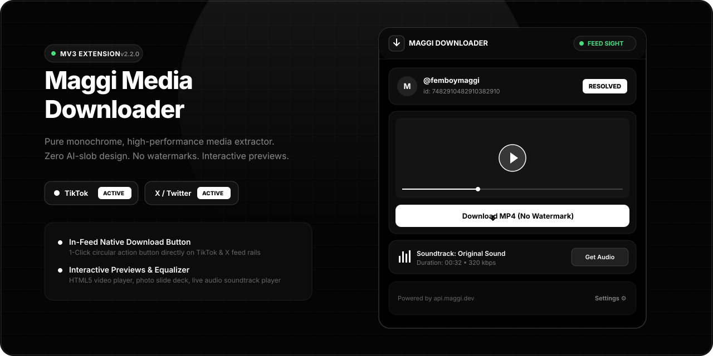
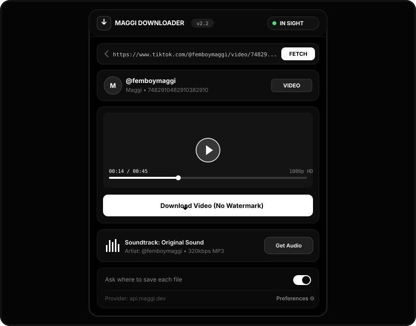
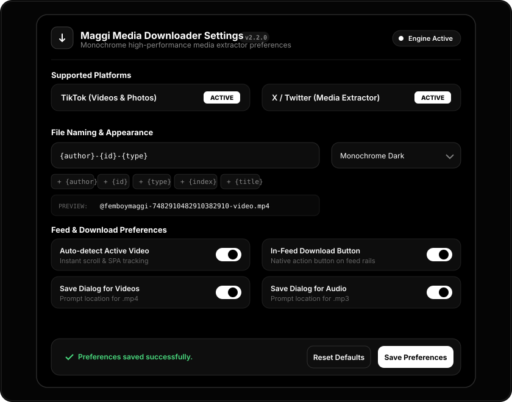
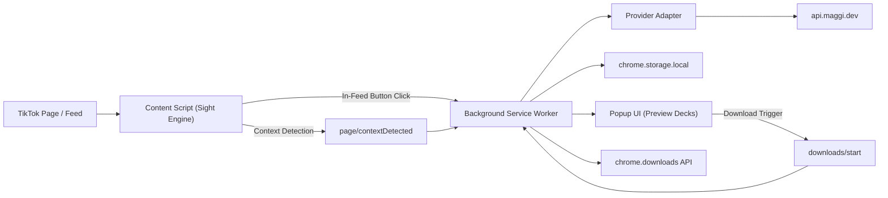
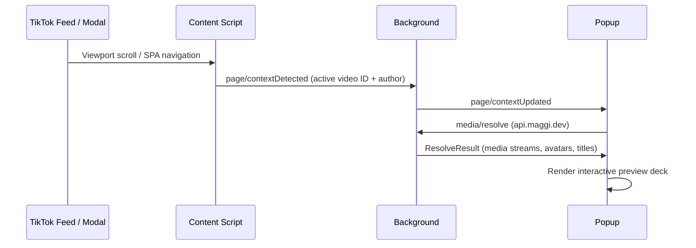
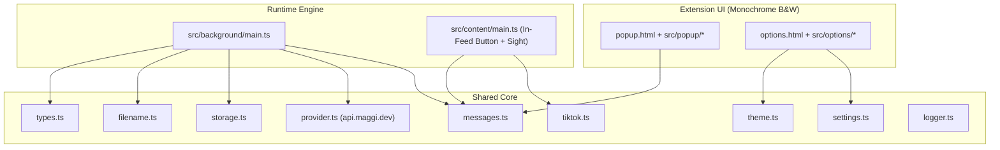

# Maggi Media Downloader



<p align="center">
  
</p>

<p align="center">
  
  
  
  
  
  
</p>

Chromium Manifest V3 multi-platform media downloader extension for TikTok and X (Twitter) featuring pure monochrome craft design, interactive media preview decks, native in-feed 1-click download actions, and typed background services.

## Overview
- **Zero AI-Slob Monochrome Aesthetic**: Pure black & white (`#000000` / `#ffffff`) high-craft design with crisp typography, subtle frosted borders, and live sight status indicators.
- **In-Feed & In-Tweet Native 1-Click Action**: Injects native download action buttons directly into TikTok's video action rails and X/Twitter's tweet action bars for instant watermark-free saving.
- **Interactive Preview Decks**: Built-in HTML5 video player, photo carousel slideshow with thumbnail ribbon, and audio soundtrack player with live equalizer.
- **High-Performance Sight Engine**: Instant 80ms viewport tracking and SPA history transitions with zero scroll lag across TikTok and X.
- **Platform Matrix**: **TikTok** (`https://api.maggi.dev/tiktok?url=...`) and **X / Twitter** (`https://api.maggi.dev/twitter?url=...`) fully active.
- **Backend Extractor**: Powered by `api.maggi.dev` with live author avatars, handles, and metadata resolution.
- **Customizable Preferences**: Dynamic filename templates with real-time token preview and quick-insert pills, theme modes, and per-media "Save As" prompts.

## Visual Previews

### Extension Popup


### Settings & Preferences


## Feature Set
- **In-Page Action Button**: 1-Click download directly inside TikTok's native feed without opening the extension popup. Deduplicated and isolated from comments.
- **Interactive Video Deck**: Preview HD videos before downloading with playback scrubbers, fullscreen mode, and direct MP4 saving without watermarks.
- **Photo Carousel Gallery**: View multi-slide photo posts, browse thumbnail strips, and download individual photos or the entire set at once.
- **Soundtrack Audio Player**: Dedicated audio deck with soundwave equalizer, author info, and direct MP3 extraction.
- **Real-Time Live Sight Indicator**: Live dot in the popup header shows whether the extension currently has a post in sight on the active tab.
- **Dynamic Filename Templating**: Customize filenames with tokens (`{author}`, `{id}`, `{type}`, `{index}`, `{title}`) with live preview in settings.
- **Quick Save Prompts**: One-click "Save As" folder prompt toggle right inside the popup and customizable in settings.
- **Multi-Platform Architecture**: Unified interface designed for TikTok with upcoming X (Twitter) support.

## Product Flow


## Live Update Flow


## Architecture Map


## Project Structure
```text
maggi-media-downloader/
├─ assets/
│  └─ safe.png
├─ docs/
│  ├─ hero-banner.svg       # Monochrome project banner
│  ├─ popup-preview.svg      # Monochrome popup UI preview
│  └─ options-preview.svg    # Monochrome settings UI preview
├─ src/
│  ├─ background/
│  │  └─ main.ts            # Download manager, context router, cache
│  ├─ content/
│  │  └─ main.ts            # Sight engine, in-feed button injection
│  ├─ options/
│  │  ├─ main.ts            # Settings controller, live token preview
│  │  └─ styles.css         # Monochrome settings styling
│  ├─ popup/
│  │  ├─ main.ts            # Interactive video/photo/audio preview decks
│  │  └─ styles.css         # Monochrome popup styling
│  └─ shared/
│     ├─ __tests__/         # Vitest unit test suite
│     │  ├─ filename.test.ts
│     │  ├─ provider.test.ts
│     │  └─ tiktok.test.ts
│     ├─ filename.ts
│     ├─ logger.ts
│     ├─ messages.ts
│     ├─ provider.ts
│     ├─ settings.ts
│     ├─ storage.ts
│     ├─ theme.ts
│     ├─ tiktok.ts
│     └─ types.ts
├─ LICENSE.txt
├─ manifest.json
├─ options.html
├─ package.json
├─ popup.html
├─ README.md
├─ tsconfig.json
└─ vite.config.ts
```

## Tech Stack
- **TypeScript 5.9** (strict typing across messages, providers, and state)
- **Vite 5.4** & `@samrum/vite-plugin-web-extension`
- **Vitest 2.1**
- **Chrome Extension Manifest V3**

## Development & Build

### Prerequisites
- Node.js 18+
- npm

### Install Dependencies
```bash
npm install
```

### Type Checking & Unit Tests
```bash
npm run typecheck
npm test
```

### Production Build
```bash
npm run build
```
The production bundle is compiled into `dist/`.

### Load Extension in Chrome / Edge / Brave
1. Run `npm run build`.
2. Navigate to `chrome://extensions`.
3. Enable **Developer mode** in the top-right corner.
4. Click **Load unpacked** and select the `dist/` directory.

## Settings Defaults
| Setting | Default | Description |
|---|---|---|
| Theme | `dark` | Pure monochrome black & white theme |
| Filename template | `{author}-{id}-{type}` | Dynamic filename pattern with tokens |
| Auto-detect active video | Enabled | Follows active viewport video on feed scroll |
| In-feed download button | Enabled | 1-Click native circular button on video action rails |
| Save dialog for video | Enabled | Prompts folder location before `.mp4` download |
| Save dialog for audio | Enabled | Prompts folder location before `.mp3` download |
| Save dialog for images | Disabled | Saves photo set directly without repeated prompts |
| Debug logging | Disabled | Detailed logging in DevTools console |

## Permissions
| Permission | Purpose |
|---|---|
| `activeTab` | Access the active tab for viewport media detection |
| `tabs` | Query tab IDs and synchronize feed context |
| `storage` | Persist preferences, cache, and recent download jobs |
| `downloads` | Download watermark-free media files |

## License
MIT License. See [LICENSE.txt](./LICENSE.txt) for details.

## Author
Developed by **Maggi** ([@N0tMaggi](https://github.com/N0tMaggi)) • [maggi.dev](https://maggi.dev)
