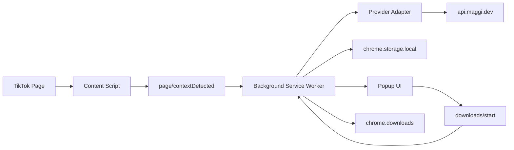
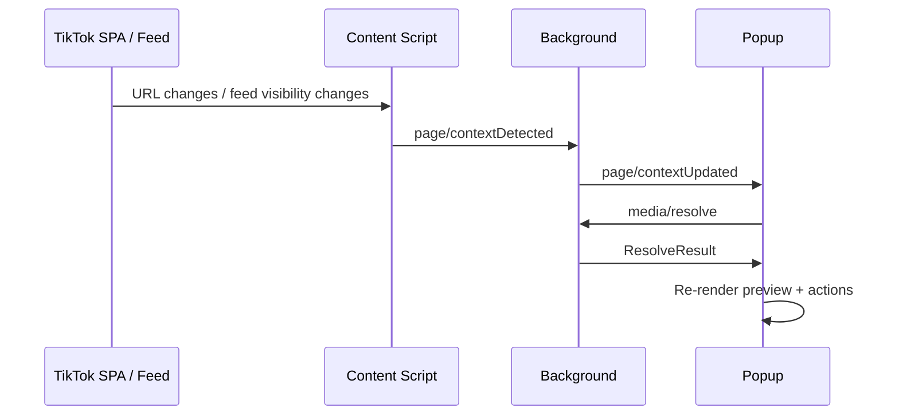
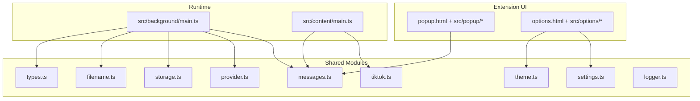
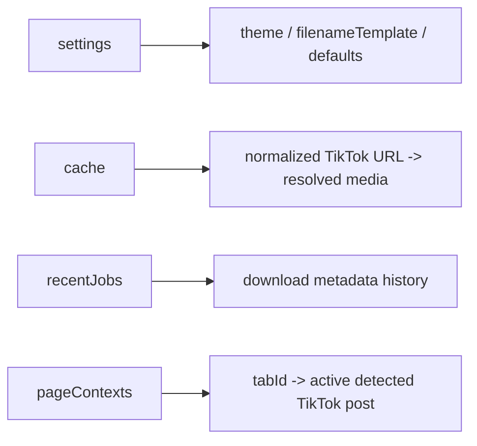

# Maggi Media Downloader


<p align="center">
  
</p>

<p align="center">
  
  
  
  
  
  
</p>

Chromium MV3 multi-platform media downloader extension for TikTok and X (Twitter) with real-time video/photo interactive previews and typed background services.

## Overview
- Modern interactive glassmorphic UI (HTML5 video player, photo slideshow gallery with thumbnail ribbon, soundtrack audio player with equalizer).
- High-performance, low-overhead content detection for SPA feed navigation.
- Platform support: TikTok (fully supported) & X/Twitter (roadmap integration ready).
- Provider adapter for `api.maggi.dev`.
- Cache, recent jobs, customizable filename templates, and theme settings.

## Visual Preview


## Feature Set
- **Interactive Previews**: Watch videos, browse photo carousel slides, and listen to audio soundtracks directly in the popup before downloading.
- **Selective Downloads**: Download single slides from a photo set or batch-download all photos.
- **Fast Content Detection**: Intercepts SPA history transitions with zero scroll lag.
- **Flexible File Naming**: Configurable tokens `{author}`, `{id}`, `{type}`, `{index}`, `{title}`.
- **Quick Settings**: Instant "Save As" toggle right inside the popup.
- **Multi-Platform Support**: Built for TikTok with architecture ready for X (Twitter).

## Product Flow


## Live Update Flow


## Architecture Map


## Project Map
```text
maggi-media-downloader/
├─ assets/
│  └─ safe.png
├─ docs/
│  ├─ hero-banner.svg
│  └─ popup-preview.svg
├─ src/
│  ├─ background/
│  │  └─ main.ts
│  ├─ content/
│  │  └─ main.ts
│  ├─ options/
│  │  ├─ main.ts
│  │  └─ styles.css
│  ├─ popup/
│  │  ├─ main.ts
│  │  └─ styles.css
│  └─ shared/
│     ├─ __tests__/
│     │  ├─ filename.test.ts
│     │  ├─ provider.test.ts
│     │  └─ tiktok.test.ts
│     ├─ filename.ts
│     ├─ logger.ts
│     ├─ messages.ts
│     ├─ provider.ts
│     ├─ settings.ts
│     ├─ storage.ts
│     ├─ theme.ts
│     ├─ tiktok.ts
│     └─ types.ts
├─ LICENSE.txt
├─ manifest.json
├─ options.html
├─ package.json
├─ popup.html
├─ README.md
├─ tsconfig.json
└─ vite.config.ts
```

## Tech Stack
- TypeScript
- Vite
- `@samrum/vite-plugin-web-extension`
- Vitest
- Chrome Extension Manifest V3 APIs

## Core Runtime Pieces
### Background
- Caches resolved media by normalized TikTok URL.
- Starts browser downloads and records recent jobs.
- Stores and serves settings and active page context.
- Broadcasts page-context updates to an open popup.

### Content Script
- Detects active TikTok video/photo posts.
- Tracks SPA transitions, DOM mutations, scrolling, and direct URL changes.
- Sends context updates and clear events to the background.
- Renders a small quick-action chip when enabled.

### Popup
- Loads the active post or manual URL.
- Displays preview data, metadata, and recent jobs.
- Starts video/audio/photo downloads.
- Updates live when the active TikTok post changes.

### Options
- Controls theme, filename template, page-action visibility, and save-as defaults.
- Writes settings back to `chrome.storage.local`.
- Shows live theme preview while editing.

## Settings Defaults
| Setting | Default |
|---|---|
| Theme | `system` |
| Filename template | `{author}-{id}-{type}` |
| Auto-detect active TikTok tab | Enabled |
| Show in-page action | Enabled |
| Save dialog for video | Enabled |
| Save dialog for audio | Enabled |
| Save dialog for images | Disabled |
| Debug logging | Disabled |

## Storage Model


## Development
### Install
```bash
npm install
```

### Run Checks
```bash
npm run typecheck
npm test
```

### Build
```bash
npm run build
```

### Load In Browser
1. Run `npm run build`.
2. Open Chrome or Edge.
3. Open the extensions page.
4. Enable developer mode.
5. Load the unpacked extension from `dist/`.

## Available Scripts
| Script | Purpose |
|---|---|
| `npm run dev` | Vite dev workflow |
| `npm run typecheck` | TypeScript validation |
| `npm test` | Vitest unit tests |
| `npm run build` | Production extension build |

## Testing
- Unit tests cover TikTok URL normalization and content-type detection.
- Unit tests cover filename-template expansion and extension assignment.
- Unit tests cover provider-payload mapping and invalid-response handling.
- Test files live under `src/shared/__tests__/`.

## Security Notes
- Download filenames are sanitized before being passed to `chrome.downloads`.
- Default UI does not expose a verbose terminal/log console.
- Host permissions are limited to TikTok and the configured provider domain.
- Persisted data stays in `chrome.storage.local`.
- Dependency audit currently reports build-time advisories that require breaking Vite/plugin upgrades rather than a safe in-place patch.

## Permissions
| Permission | Why it is needed |
|---|---|
| `activeTab` | Access the current tab for popup detection |
| `tabs` | Query active tab and tab IDs for context sync |
| `storage` | Persist settings, cache, page contexts, recent jobs |
| `downloads` | Start file downloads |

## Manifest Surface
| Surface | Entry |
|---|---|
| Background service worker | `src/background/main.ts` |
| Content script | `src/content/main.ts` |
| Popup page | `popup.html` -> `src/popup/main.ts` |
| Options page | `options.html` -> `src/options/main.ts` |

## License
This project is licensed under the MIT License.

See [LICENSE.txt](./LICENSE.txt) for the full text.

## Credits
- Original project name and icon branding: Maggi
- Extension build system: Vite + `@samrum/vite-plugin-web-extension`
- Testing: Vitest
